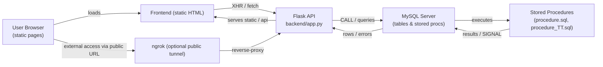
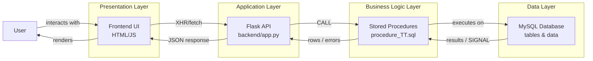

# Pipeline Structure & Run Map

This document describes the project's pipeline components, initialization order, and a concise run map (how to bring the system online locally). Use this as a quick reference when developing, testing, or re-deploying the app.

---

## Architecture Map (Mermaid)



Open the above map in any Markdown viewer that supports Mermaid or use the `renderMermaidDiagram` helper when reviewing visually.

## Detailed process: Flask, MySQL and ngrok

This section explains how the three runtime components interact during startup and at request time.

1) Startup / deploy sequence (run_deploy.bat)
  - `run_deploy.bat` (Windows) orchestrates the environment:
    - Ensures `.venv` and `.env` are present.
    - Detects and starts a MySQL service or falls back to launching `mysqld.exe`.
    - Waits for MySQL to accept connections on port 3306.
    - Calls `scripts\init_db.bat` -> `scripts/init_db.py` to execute SQL files in order (DDL, triggers, procedures, seed data). Note: `init_db.py` splits statements by `DELIMITER` tokens so procedure files must use explicit `DELIMITER` lines.
    - Starts the Flask app (`backend\app.py`) and then `ngrok` to expose the app publicly (optional).

2) MySQL responsibilities
  - Hosts schema (tables), seed data, triggers and stored procedures/functions.
  - Business logic is pushed into stored procedures (e.g. `ThongKeDuNoKhoanVay`, `ThemGiaoDich`, `sp_XoaKhoanVay`).
  - Procedures may raise errors with `SIGNAL SQLSTATE '45000'` and a message; the Flask app will surface that message to clients.

3) Flask responsibilities
  - Serves static HTML pages and provides JSON API endpoints (see `backend/app.py`).
  - For business operations, Flask behaves as a thin controller that delegates to DB procedures. Example pattern used throughout the app:

```py
cur.execute("CALL ThongKeDuNoKhoanVay(%s, %s)", (status, min_paid))
rows = cur.fetchall()
while cur.nextset():
    pass
```

  - Error handling: DB exceptions (including `SIGNAL` messages) are caught and returned in JSON using the `_sql_message(ex)` helper, so the client receives the DB-provided error text.

4) ngrok responsibilities
  - `ngrok` provides an optional public tunnel to the local Flask port.
  - Useful for testing webhooks or sharing a running local app with external testers.
  - Security note: exposing a local dev server publicly may leak endpoints; protect admin routes with auth and consider disabling ngrok when not needed.

5) Typical request flow (customer view)
  - Browser loads `loan-details.html` from Flask (static handler).
  - User opens Statistics tab and clicks Run. Frontend sends a fetch to `/api/loan-statistics/<cccd>?status=...&min_paid=...`.
  - Flask endpoint `get_loan_statistics` locates the customer's account number, then issues `CALL ThongKeDuNoKhoanVay(%s, %s)` for one or several statuses.
  - MySQL executes the stored procedure, which aggregates loan payment rows and returns result rows.
  - If a business rule is violated (e.g., permission check), procedure uses `SIGNAL` to raise an error; Flask catches and returns the message to the client as JSON.
  - Frontend renders the returned rows into the statistics table.

6) Where to call procedures from `app.py` (example)
  - The app already calls `CALL ThongKeDuNoKhoanVay` in the `get_loan_statistics` endpoint (see `backend/app.py`). To call the same proc elsewhere, follow the code pattern above using `cur.execute` or `cur.callproc`.

7) Troubleshooting
  - If a procedure is not present at runtime, re-run `scripts/init_db.py` (or `run_deploy.bat`) and check `SQL/procedure_TT.sql` contains proper `DELIMITER` usage (`DELIMITER $$` / `END $$` / `DELIMITER ;`).
  - If you get DB SIGNAL messages, inspect the message text returned by the API; it normally contains the procedure's `MESSAGE_TEXT`.


## Repo overview (key paths)

- `backend/` — Flask API and DB helpers (`backend/app.py`, `backend/db.py`).
- `SQL/` — DDL, DML, triggers, functions and stored procedures (e.g. `procedure.sql`, `procedure_TT.sql`, `banking.sql`).
- `scripts/` — DB init helpers (`scripts/init_db.py`, `scripts/init_db.bat`).
- `run_deploy.bat` — Orchestrates MySQL startup, DB initialization and starts the Flask app + `ngrok` tunnel (Windows).
- Frontend HTML pages at repo root (e.g. `loan-details.html`, `admin-home.html`) — served as static files by Flask.
- `.env.example` — environment template (copy to `.env` and update values).

---

## Pipeline components (what each piece does)

- SQL files (executed by `scripts/init_db.py` in defined order):
  1. `delete_all_table.sql` — cleans existing schema/tables.
  2. `banking.sql` — core table definitions.
  3. `trigger_TT.sql` — triggers (if any).
  4. `procedure.sql` — API helper stored procedures / id generators.
  5. `procedure_TT.sql` — business procedures (e.g. `ThongKeDuNoKhoanVay`, `ThemGiaoDich`, `sp_ThemKhoanVay`, `sp_XoaKhoanVay`).
  6. `funct.sql` — SQL functions used by the app.
  7. `data.sql` / `admin_dataset.sql` — seed data.

- `scripts/init_db.py` — reads SQL files and executes statements. It treats `DELIMITER` directives when they appear on their own lines, so procedure files must use explicit `DELIMITER` tokens (e.g. `DELIMITER $$` / `END $$` / `DELIMITER ;`).

- `backend/db.py` — provides `get_connection()` built from environment variables (`DB_HOST`, `DB_PORT`, `DB_USER`, `DB_PASSWORD`, `DB_NAME`).

- `backend/app.py` — Flask application (API endpoints, static file server). It calls stored procedures (e.g. `CALL ThongKeDuNoKhoanVay(%s, %s)`) to keep business logic in DB.

- `run_deploy.bat` — convenience script (Windows) that:
  - ensures a Python `.venv` exists and `.env` is present,
  - checks/starts MySQL service (or falls back to direct `mysqld.exe`),
  - calls `scripts/init_db.bat` to execute SQL files,
  - starts the Flask app (`python backend\app.py`) and launches `ngrok`.

---

## Run map — step by step (recommended)

Prerequisites:
- MySQL Server installed and accessible (default host `127.0.0.1`, port `3306`).
- Python 3.10+ and `python -m venv` available.
- Windows: run commands below from a PowerShell session (or use the CLI equivalents).

1) Prepare environment

- Copy `.env.example` to `.env` and update DB credentials.
  - Required variables: `DB_HOST`, `DB_PORT`, `DB_USER`, `DB_PASSWORD`, `DB_NAME`.
  - NOTE: the DB initialization script creates a database named `banking`; ensure `DB_NAME` aligns with the database you want to use (either set to `banking` or adjust the script).

2) Create & activate virtualenv and install requirements

PowerShell (recommended):

```powershell
python -m venv .venv
Set-ExecutionPolicy -Scope Process -ExecutionPolicy RemoteSigned
& .\.venv\Scripts\Activate.ps1
pip install -r requirements.txt
```

(or in CMD)

```cmd
.venv\Scripts\activate.bat
pip install -r requirements.txt
```

3) Initialize database + start app (two options)

Option A — single-step (recommended on Windows):

```powershell
.\run_deploy.bat
```

- What `run_deploy.bat` does: detects/starts MySQL service, waits for port 3306, calls `scripts\init_db.bat` which runs `scripts/init_db.py` to execute SQL files in the correct order, then starts the Flask app and ngrok.

Option B — manual (useful when debugging SQL load problems):

```powershell
# 1. Initialize DB from SQL files (will print progress/errors)
.\.venv\Scripts\python.exe scripts\init_db.py

# 2. Start Flask app
python backend\app.py
```

- If you use manual init, pay attention to procedure files that use `DELIMITER` — `scripts/init_db.py` expects `DELIMITER` on its own line (e.g. `DELIMITER $$`). If procedures fail to load, inspect the SQL files for `DELIMITER` placement.

4) Access the app

- App server (local): http://localhost:8080
- Example pages:
  - Customer loan page: http://localhost:8080/loan-details.html
  - Admin console: http://localhost:8080/admin-home.html

5) Quick API checks (curl examples)

- Loan statistics (customer view):

```bash
curl "http://localhost:8080/api/loan-statistics/012345678901?status=Qua_han&min_paid=50000000"
```

Response (successful): JSON object with `statistics` (array), `totalLoans`, `cccd`, and `message`. Each `statistics` entry contains fields from `ThongKeDuNoKhoanVay` like `Ma_khoan_vay`, `So_tai_khoan`, `Tong_von_vay`, `Tong_goc_da_tra`, `Du_no_goc_con_lai`.

- Retrieve loans with remaining debt (function-backed):

```bash
curl "http://localhost:8080/api/loans-with-debt/012345678901"
```

6) Admin flows & DB-enforced rules

- Important stored procedures live in `SQL/procedure_TT.sql` (e.g. `sp_XoaKhoanVay`) and may SIGNAL errors on violations (e.g. insufficient admin level). The Flask backend catches DB exceptions and returns the SQL SIGNAL message in JSON (see `backend/app.py` error handling helper `_sql_message`).

---

## Troubleshooting tips

- SQL procedure load failures:
  - Check that the procedure file contains `DELIMITER` tokens on their own lines, e.g.:

    ```sql
    DELIMITER $$
    CREATE PROCEDURE ...
    BEGIN
      ...
    END $$
    DELIMITER ;
    ```

  - `scripts/init_db.py` splits statements using the current delimiter; missing or inline `DELIMITER` lines will break the parser.

- Missing `.env` or wrong `DB_NAME`:
  - `run_deploy.bat` fails early if `.env` is missing. Copy and edit `.env.example` first.
  - Ensure `DB_NAME` matches the database created by `scripts/init_db.py` (default `banking` in the init script).

- MySQL doesn't start via service:
  - `run_deploy.bat` attempts to detect common service names and falls back to launching `mysqld.exe` if configured. If your MySQL installation differs, start MySQL manually (Services or MySQL Workbench).

- Virtualenv problems:
  - Create `.venv` with `python -m venv .venv` and then run `pip install -r requirements.txt`.

- Port conflicts (Flask default 8080):
  - Change `FLASK_PORT` in `.env` or set `FLASK_PORT` env var before starting. `backend/app.py` reads `FLASK_PORT`.

---

## Useful file references

- SQL business procedures: `SQL/procedure_TT.sql`
- SQL API helper procedures: `SQL/procedure.sql`
- DB init script: `scripts/init_db.py`
- Deploy orchestration (Windows): `run_deploy.bat`
- Flask app & static server: `backend/app.py`
- DB connection helper: `backend/db.py`

---

## ASCII Architecture Map (Boxes & Arrows)

```
+-------------------+     +-------------------+     +-------------------+
|   User Browser    | --> |   Frontend HTML   | --> |   Flask API        |
|   (static pages)  |     |   (static files)  |     |   (backend/app.py) |
+-------------------+     +-------------------+     +-------------------+
                                   |                           |
                                   | XHR/fetch                | CALL / queries
                                   v                           v
+-------------------+     +-------------------+     +-------------------+
|   Frontend JS     | --> |   Flask API        | --> |   MySQL Server    |
|   (event handlers)|     |   (backend/app.py) |     |   (tables & procs)|
+-------------------+     +-------------------+     +-------------------+
                                   ^                           |
                                   | JSON responses           | results / SIGNAL
                                   |                           v
+-------------------+     +-------------------+     +-------------------+
|   Frontend Render | <-- |   Flask API        | <-- |   Stored Procs    |
|   (DOM updates)   |     |   (backend/app.py) |     |   (procedure.sql) |
+-------------------+     +-------------------+     +-------------------+
                                   |                           |
                                   | serves static            | executes
                                   v                           v
+-------------------+     +-------------------+     +-------------------+
|   ngrok Tunnel    | --> |   Public Access    |     |   Business Logic  |
|   (optional)      |     |   (external URL)   |     |   (procedure_TT.sql)|
+-------------------+     +-------------------+     +-------------------+
```

Arrows show data flow: user interactions trigger JS → API calls → DB procedures → results back to UI.

---

## UI Interactions & Triggered Flows

This section maps user interactions (HTML elements + events) to the backend flows they trigger. Each entry shows: HTML element ID, event type, JS function called, API endpoint invoked, and stored procedure executed (if any).

### Customer Pages

#### `loan-details.html` — Loan Statistics Tab
- **Element**: `#runStatsBtn` (button in Statistics tab)
  - **Event**: `click`
  - **JS Function**: `loadStatistics(cccd, status, minPaid)` — reads values from `#statStatusSelect` and `#statMinPaidInput`, then fetches data.
  - **API Endpoint**: `GET /api/loan-statistics/<cccd>?status=<value>&min_paid=<value>`
  - **Stored Procedure**: `CALL ThongKeDuNoKhoanVay(status, min_paid)` — aggregates loan payment data by status and minimum paid amount.
  - **Result**: JSON with `statistics` array (filtered by customer's account), rendered into `#statisticsTable` via `renderStatistics()`.

- **Element**: `#tab-statistics` (tab link)
  - **Event**: `click`
  - **JS Function**: Shows `#statisticsView` div and enables Run button; calls `loadStatistics()` if data not loaded.
  - **API Endpoint**: Same as above (when Run is clicked).
  - **Stored Procedure**: Same as above.
  - **Result**: Displays statistics controls and table.

#### `transaction-history.html` — Transaction History
- **Note**: Edit/Delete buttons and inline editors have been removed. No UI triggers call transaction update/delete endpoints. Only view/read operations are available.
- **Element**: `#loadTransactionsBtn` (if present)
  - **Event**: `click`
  - **JS Function**: `loadTransactions(cccd)` — fetches transaction list.
  - **API Endpoint**: `GET /api/transactions/<cccd>`
  - **Stored Procedure**: None (direct query).
  - **Result**: Renders transaction table.

### Admin Pages

#### `admin-home.html` — Loan Management
- **Element**: `#deleteLoanBtn` (delete button in loan management section)
  - **Event**: `click`
  - **JS Function**: `deleteLoanManagementLoan()` — prompts for deletion reason, then sends DELETE request with Authorization header.
  - **API Endpoint**: `DELETE /api/admin/loans/delete` (body: `{loanId, reason}`)
  - **Stored Procedure**: `CALL sp_XoaKhoanVay(loanId, admin_maSo, reason)` — checks admin's `Cap_do_truy_cap` level; SIGNALs error if insufficient privilege (e.g., "Admin level too low to delete loans").
  - **Result**: JSON with success message or DB SIGNAL error (e.g., "Admin level too low to delete loans"); UI shows alert and refreshes loan list on success.

- **Element**: `#updateLoanBtn` (update button)
  - **Event**: `click`
  - **JS Function**: `updateLoanManagementLoan()` — collects form values and sends POST request.
  - **API Endpoint**: `POST /api/admin/loans/update` (body: loan fields like `interestRate`, `termMonths`, etc.)
  - **Stored Procedure**: `CALL sp_SuaKhoanVay(loanId, interestRate, termMonths, principalCycle, status, admin_maSo)` — updates loan with admin validation.
  - **Result**: JSON with success message; UI refreshes loan list.

- **Element**: `#loadLoanBtn` (load loans button)
  - **Event**: `click`
  - **JS Function**: `loadLoanManagementLoans()` — fetches all loans for management.
  - **API Endpoint**: `GET /api/admin/loans`
  - **Stored Procedure**: None (direct query).
  - **Result**: Renders loan management table.

### Other Pages (General Flows)
- **Login/Register Pages** (`admin-login.html`, `register.html`): Submit forms trigger `POST /api/login` or `POST /api/register` — direct DB queries, no stored procedures.
- **Create Transaction/Account Pages** (`create-transaction.html`, etc.): Submit forms trigger `POST /api/transactions` — calls `CALL ThemGiaoDich(...)` from `procedure_TT.sql`.
- **Loan Creation** (`create-loan.html`): Submit triggers `POST /api/loans` — calls `CALL sp_ThemKhoanVay(...)`.

For any interaction, if a DB procedure SIGNALs an error (e.g., business rule violation), the Flask API catches it and returns the message in JSON (`{"message": "DB error text"}`), which the frontend displays as an alert.

---

## Next steps & checklist

- [ ] Run `.\run_deploy.bat` and verify the app is reachable at `http://localhost:8080`.
- [ ] Open `loan-details.html` and test the "Statistics (Procedure)" tab and the Run button.
- [ ] If stored procedures are modified, re-run `scripts/init_db.py` to push changes to the DB.


---

## Data Flow Diagram (DB → Procedures → API → UI)


